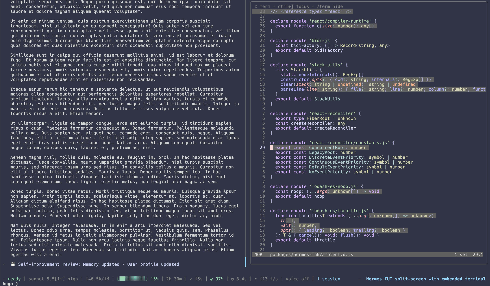

# hermes-term-widget

> **Disclaimer:** this repo is 100% vibe coding. The code was written by an AI agent and only tested by driving a real TUI session by hand. Review it before you trust it, and expect rough edges.

A split-screen terminal for the [Hermes Agent](https://hermes-agent.nousresearch.com/docs) TUI.
The chat stays on the left; a real shell lives in a half-width rail on the right.

- `/term` docks the terminal and focuses it. Run it again to hide the rail (the shell keeps running).
- `/termfocus` gives the keyboard to the terminal.
- `ctrl+]` toggles the keyboard between the chat composer and the terminal while the rail is docked.
- `ctrl+\` or `ctrl+/` shows or hides the rail from anywhere: it docks and focuses the terminal, or collapses it to a thin strip. The shell keeps running while hidden.

Tip: type a trailing space (`/term `). The slash popover fuzzy-ranks, so `/term` + Enter can select `/redraw`.



## Requirements

- Hermes Agent with the Ink TUI (`hermes --tui`). Developed against v0.22.7.
- `tmux` on `PATH` (developed with 3.8). The widget SDK has no PTY or terminal emulator, so a private tmux server provides both.
- Node ESM runtime as shipped with the Hermes TUI. No build step, no dependencies.

## Install

Widgets are plain `.mjs` files loaded from `$HERMES_HOME/tui-widgets/` (`~/.hermes/tui-widgets/` for the default profile).

```sh
# for a specific profile
cp term.mjs ~/.hermes/profiles/<profile>/tui-widgets/term.mjs

# or the default profile
cp term.mjs ~/.hermes/tui-widgets/term.mjs
```

A running TUI hot-loads the file within about a second. Run `/widgets-reload` to force a rescan; the transcript should list `term.mjs` under `loaded:`.

To use it for every profile, symlink instead of copying.

Uninstall: delete the file. The `ctrl+]` hook is removed with it.

## How it works

- A private tmux server (socket `hermes-tuiterm`, session `term`) runs your shell. It never touches your normal tmux server.
- An **ambient** right-side rail polls `tmux capture-pane -p -e` every 200 ms, parses the SGR colors into styled `Text` spans, and paints the screen. The chat transcript reflows into the left half.
- A **modal** focus app forwards keystrokes with `tmux send-keys`, serialized so fast typing and pastes keep their order.
- The rail resizes with the terminal; the inner tmux window follows.
- The terminal cursor is painted only when the program shows the real cursor (`#{cursor_flag}` = 1). Programs such as Helix hide it and draw their own.

### Why ctrl+\ and not ctrl+t

`ctrl+t` is already a built-in Hermes binding (the agents / work monitor), and binding it here would shadow that. `ctrl+\` (byte `0x1c`) is unused by the Hermes TUI. Both chords are matched in their bare form and in the kitty keyboard protocol form (`ESC[92;5u` / `ESC[93;5u`). The chords are the `CTRL_BACKSLASH` and `CTRL_RBRACKET` constants at the top of `term.mjs`.

The widget SDK can open a widget but not close one, so "hide" collapses the rail to a 2-column strip instead of removing it. Consequence: `/term` while the rail is collapsed removes that strip without showing anything, and a second `/term` docks the terminal again. Use `ctrl+\` to avoid the extra step.

### The ctrl+] and ctrl+\ hook

The widget SDK has no global hotkeys: ambient widgets receive no keys, and the input handler only talks to a widget while a modal is open. To toggle focus from the composer, the widget wraps `process.stdin.read`:

- A lone `ctrl+]` chunk (bare `0x1d`, or the kitty-protocol form `ESC[93;5u`) is acted on only while the rail is docked. A lone `ctrl+\` chunk (`0x1c`, or `ESC[92;5u`) or `ctrl+/` chunk (`0x1f`, `ESC[47;5u`, or `ESC[55;5u`/`ESC[55;6u` for layouts where `/` is shift+7) is acted on in every state.
- The original `read` is restored on hot reload, and any error falls back to plain pass-through.
- To swallow the key it delegates to the real `read()` and never returns `null` itself. Returning `null` skips a call Node needs to re-arm `readable` and freezes all TUI input.

This is a hack on the TUI's input path; a future Hermes release could break it. Removing the file undoes it.

## Behavior notes and limitations

- While the terminal is focused, the composer is blocked. Press `ctrl+]` to get it back.
- `ctrl+]` and `ctrl+\` are reserved inside the terminal. Programs that use them will not see them: `telnet` uses `ctrl+]`, and `ctrl+\` is the shell's SIGQUIT key.
- `ctrl+/` also sends `0x1f` in many terminals, the same byte as `ctrl+_` and `ctrl+7`, so those toggle the rail too. Change `CTRL_SLASH` if that gets in your way.
- `ctrl+\` can be awkward to type on some non-US keyboard layouts. Change `CTRL_BACKSLASH` if so.
- Mouse and scrollback inside the rail are not forwarded.
- Keystrokes can lag by up to about 200 ms (poll interval, plus a quick refresh after each key).
- Rail height is `rows - 4` (see `cardHeight()`), leaving room for the status bar and composer. A multi-line composer could overlap a taller card.
- The rail is half the screen width, fixed at launch and on resize.
- Exiting the shell starts a fresh one.
- Known cosmetic issue: Helix inside the rail can look slightly off. Not fully diagnosed. Nerd-font glyphs may also leave the right border off by a column on some rows.
- A live rail keeps running the code it was mounted with. After editing the file, hide and re-show it (`/term ` twice).

## Tested

Driven through a real `hermes --tui` session in tmux (200x50): dock and focus, typing including a trailing `;`, Enter, arrows, Ctrl+C, colors, `hx` (insert mode, Esc), resize, shell restart after `exit`, hide/show, and the `ctrl+]` toggle in both directions with both key encodings.

## License

MIT
